<div align="center">



**First in the block. First to the kill.**

Solana bot that catches fresh pump.fun V3 launches, checks the dev buy and backruns it with a Jito bundle in the same block.


</div>

---

## 🩸 The hunt

| # | Step | What happens |
|:-:|---|---|
| 1 | **Subscribe** | connects to the Helius WebSocket and opens `logsSubscribe` on the pump.fun V3 program |
| 2 | **Detect** | classifies logs to find `BondingCurveV3` / `BondingCurveJupiter` creates |
| 3 | **Parse** | pulls the mint, SOL amount and reserves out of the trade event |
| 4 | **Filter** | minimum dev buy, bonding curve state, position limit, cooldown |
| 5 | **Buy** | builds a BuyV2 transaction with ATA creation and a Jito tip |
| 6 | **Bundle** | sends the signed transaction as a Jito bundle through the Block Engine |
| 7 | **Monitor** | tracks open positions until take profit, stop loss or timeout |
| 8 | **Sell** | builds a SellV2 transaction and lands it as a Jito bundle |

```
 launch ──▶ logsSubscribe ──▶ parse ──▶ filter ──▶ BuyV2 + tip ──▶ Jito bundle
                                                                    │
                       SellV2 bundle ◀── TP / SL / timeout ◀── position
```

## 🦇 Setup

```bash
git clone https://github.com/zostaff/firstblood.git
cd firstblood
npm install
cp .env.example .env   # put your keys here
```

### Environment

| Variable | Description | Default |
|---|---|:-:|
| `RPC_WSS` | Helius WebSocket endpoint | - |
| `RPC_URL` | Helius HTTP endpoint | - |
| `HELIUS_API_KEY` | Helius API key | - |
| `WALLET_PRIVATE_KEY` | Base58 private key | - |
| `BACKRUN_BUY_SOL` | SOL per buy | `0.1` |
| `BACKRUN_JITO_TIP` | Jito tip per bundle | `0.001` |
| `BACKRUN_TAKE_PROFIT` | Take profit multiplier | `2.0` |
| `BACKRUN_STOP_LOSS` | Stop loss multiplier | `0.5` |
| `BACKRUN_TIMEOUT_SEC` | Position timeout | `60` |
| `BACKRUN_MIN_DEV_BUY` | Minimum dev buy in SOL | `0.5` |
| `BACKRUN_MAX_POSITIONS` | Max concurrent positions | `3` |
| `BACKRUN_COOLDOWN_SEC` | Cooldown between buys | `5` |

## ⚰️ Run

```bash
npm start            # live
npm run dry          # dry run, no real transactions
node bot.js --dry-run
```

## 🧛 Anatomy

```
bot.js              main entry, orchestration
lib/
  config.js         env to config object
  constants.js      program IDs, tip accounts, discriminators
  logger.js         colored console output
  listener.js       WebSocket logsSubscribe
  parser.js         log classification, trade event parsing
  pda.js            PDA derivation (bonding curve, ATA)
  bonding.js        bonding curve state and math
  tx-builder.js     buy and sell transaction construction
  jito.js           Jito Block Engine bundle submission
  positions.js      position tracking, TP / SL / timeout
```

## ⚠️ Risk warning

Experimental software for educational purposes. Trading memecoins is extremely risky and you can lose everything you put in. Use at your own risk.

<div align="center">
<sub>🩸 FIRSTKILLER</sub>
</div>
